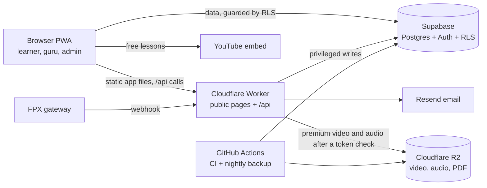

# AQRJ LMS — Build Plan

> **Version 0.1.** Kept for its reasoning. Where it differs from [ROADMAP.md](ROADMAP.md) (plans and prices, scale, SvelteKit 3), the roadmap is right.

**Akademi Quran Raudhatul Jannah (AQRJ) · Kelas Mengaji Al-Quran**

Version 0.1, draft for iteration · 16 Nov 2026

Prices and limits were checked on 16 Nov 2026 and change often. USD is converted at about RM4.10. Sources are in Appendix D. Items marked **(verify)** are ones I could not confirm from a primary source.

---

## 1. Summary

AQRJ LMS is a video-first, phone-first web app (PWA) for about 200 learners. A learner watches short lessons, records their recitation, and gets feedback from an ustaz or ustazah. There is a Free tier and a Premium tier.

| Question | Answer |
|---|---|
| What drives the design? | Video costs almost nothing to deliver. Teacher time is the scarce resource. So **Free is what a computer can serve** (videos, quizzes, progress tracker) and **Premium is what needs a teacher** (tasmik feedback, live talaqqi, sijil). |
| Stack | SvelteKit, Supabase (Postgres and Auth), Cloudflare Workers and R2 |
| Video | YouTube for free lessons. Self-hosted HLS on Cloudflare R2 for premium lessons |
| Payments | FPX through a Malaysian gateway at about RM1 per payment, with manual transfer as fallback |
| Platform cost at 200 learners | RM0 a month, plus a domain at about RM46 a year |
| Mobile | PWA now. The same code is wrapped with Capacitor for Android and iOS later |
| Path to launch | 6 milestones, then a pilot with 10 to 20 learners |
| Biggest risks | Not the code: lesson recording, teacher capacity, gateway onboarding, and the rules on showing Quran text |

---

## 2. Assumptions to confirm

1. About 200 learners in year one. The design should reach about 500 without re-architecture.
2. Learners are a mix of children (managed by a parent) and adults, including older adults.
3. There are 3 to 8 teachers, both ustaz and ustazah.
4. Teaching is pre-recorded lessons plus recorded recitation (tasmik) reviewed by a teacher. Live talaqqi over Google Meet or Zoom is optional.
5. Bahasa Melayu is the main interface language. English is optional.
6. Fees are collected in MYR by FPX or DuitNow, into an account that belongs to AQRJ.
7. You are the main developer and maintainer, part-time, building with AI help.
8. AQRJ owns its teaching material (videos, notes, exercises).

If any of these is wrong, tell me before we build. Numbers 3, 4 and 6 change the design the most.

---

## 3. What we take from the best LMSs

| Platform | What it does best | What AQRJ takes | When |
|---|---|---|---|
| Udemy | Course → sections → short lectures, resume where you stopped, playback speed, free preview lectures | The same structure, a "Sambung belajar" button, pratonton percuma | MVP |
| Coursera | Watch for free, pay for graded work and the certificate. Financial aid | The Free/Premium line. Sponsored seats (tajaan) for learners who cannot pay | MVP |
| Google Classroom | Assignment → submission → teacher feedback | The tasmik loop, which is the heart of the product | MVP |
| Duolingo | Daily habit: short sessions, streak, reminders | An "Istiqamah" streak and a daily goal, kept private | MVP (light) |
| Skool, Circle | Calendar, announcements, community, leaderboard | Jadual kelas and announcements. No public leaderboard | MVP |
| Teachable, Thinkific | Coupons, bundles, drip release | Coupons and a family discount | v1.1 |
| Khan Academy | Mastery per skill | A tajwid mastery map (which hukum the learner has passed) | v1.1 |
| Tarteel, Quran.com | Mushaf reader, verse audio, hafazan tracking, AI mistake detection | Progress tracking now. Ayat display and AI pre-check later (see 7.5) | MVP / v2 |
| Moodle | Roles and reports | The role model and a parent report | MVP / v1.1 |

Left out on purpose: forums and direct messages (moderation load and child safety), public leaderboards, instructor marketplaces and payouts, SCORM, a complex gradebook.

---

## 4. Users and roles

| Role | Who | Can do |
|---|---|---|
| Akaun (account) | A parent or an adult learner. This is the login | Manage learner profiles, pay, see reports |
| Pelajar (learner profile) | The person learning. One account holds one or more, picked on a "Siapa yang belajar?" screen | Watch, do quizzes, submit tasmik |
| Guru (ustaz, ustazah) | Teachers | Review tasmik, run class groups, mark attendance, update Quran progress |
| Admin | AQRJ staff | Content, people, payments, reports |

Why profiles sit under one account: children need no email or password, a family pays in one place, siblings can share a phone, and Malaysia's data protection rules require a parent or guardian to consent for anyone under 18.

---

## 5. Free and Premium

| Feature | Percuma | Premium |
|---|---|---|
| Free courses (for example the first level of each programme) | Yes | Yes |
| Premium courses | Preview lessons only | Yes, for every profile on the account |
| Quizzes, progress tracker, streak | Yes | Yes |
| Tasmik: record, then get teacher feedback | 1 trial | Yes, with a weekly quota for each paid learner |
| Place in a live talaqqi class | No | Yes, for each paid learner |
| Sijil (certificate) | No | Yes |
| Nota PDF | No | Yes |
| Parent report | Basic | Detailed |

How it works:

- **Premium is sold per learner as a prepaid pass** of 30, 90 or 365 days. There is no auto-renew in the MVP, because FPX is the cheapest way to pay and each FPX payment is a one-off. The app reminds the account 7, 3 and 1 days before expiry and allows a 3-day grace period.
- **Video unlocks for the whole account** once any learner on it has an active pass. **Teacher time belongs to the paid learner.** This is fair to families and simple to enforce.
- **Tajaan (sponsored seat):** an admin can grant a pass without payment, for asnaf learners, staff children or promotions. It is the same record with a different source.
- **Prices live in a `plans` table** that an admin edits. No amount is hardcoded.
- **Teacher capacity sets the price, not hosting.** Example: 120 paid learners × 2 submissions a week × about 4 minutes each comes to about 16 teacher-hours a week.

---

## 6. Scope by release

**MVP (v1.0)**

1. Sign-in with Google or email, learner profiles, consent records
2. Catalog → course → module → lesson (video, text, PDF, quiz)
3. Player that resumes and marks completion, plus "Sambung belajar"
4. Free and Premium gating
5. Tasmik loop: record, submit, teacher queue, feedback
6. Payments: FPX gateway, manual transfer fallback, receipts, expiry reminders
7. Class groups, session schedule with a meeting link, attendance
8. Announcements, in-app notifications, email
9. Admin: content editor, learners, passes, orders, simple reports
10. Installable PWA with an offline shell. BM first, English-ready

**v1.1:** sijil with QR verification · coupons and family discount · web push · lesson Q&A answered by teachers · weekly parent report · hafazan tracker with murajaah reminders · bank-statement matching for manual payments

**v2:** Android and iOS apps · offline lesson downloads · in-app ayat display (after the check in 7.5) · AI-assisted recitation pre-check · auto-renew by card or e-mandate

---

## 7. Quran-specific design

### 7.1 Programme ladder

A placeholder for the asatizah to correct: Iqra' 1–6 → Bacaan Al-Quran (Tahsin) → Tajwid Asas → Tajwid Lanjutan → Hafazan (Juz 30 onward). The ladder is stored as data (`programs` → `courses`), so changing it needs no code.

### 7.2 The tasmik loop

1. The learner taps record, in the style of a WhatsApp voice note. Maximum length is 3 minutes (configurable). They listen back, then submit with a reference: Iqra' book and page, or surah and ayat range.
2. The browser records mono speech at about 32 kbps, which is about 0.24 MB a minute. The file goes straight to private storage on R2.
3. The submission is routed to a teacher by class group. A gender rule applies by default: recordings from muslimat learners go only to an ustazah. An admin can override it.
4. The teacher's review screen has playback with speed control, one-tap mistake tags (Makhraj, Sifat huruf, Mad, Ghunnah, Qalqalah, Waqaf dan ibtida', Kelancaran), a rating (Lancar, Sederhana, Ulang semula), a short note and an optional voice reply. Keyboard shortcuts keep a review under 4 minutes.
5. The learner is notified. "Ulang semula" reopens the task.
6. Every review becomes a row in the learner's digital Buku Rekod Tasmik.
7. Recordings are deleted automatically 90 days after review (configurable). This keeps personal data to a minimum and keeps storage inside the free allowance.

### 7.3 Progress tracking

Three tracks, updated by the teacher at tasmik or talaqqi and visible to the parent: Iqra' (book and page), Tilawah (juz, page, surah), Hafazan (surah and ayat ranges).

### 7.4 Adab and safety by design

- Recordings are private. Only the learner's account, the assigned teacher and admins can play them, through links that expire in minutes.
- No public profiles and no learner-to-learner messaging.
- Teacher and learner communicate only through tasmik feedback and announcements, and all of it is logged.

### 7.5 Two legal points to settle before showing Quran text or book pages

**Quran text.** Malaysia regulates Quran text under the Akta Pencetakan Teks Al-Qur'an 1986. An amendment took effect on 1 September 2023. KDN officials have said publicly that anyone may develop a Quran app provided it receives a perakuan (certification), and that KDN monitors local Quran apps that lack one. I cannot tell you how this applies to an LMS that shows a few ayat beside a lesson.

- MVP position: show references only (surah and ayat numbers, page numbers). Learners read from their own KDN-approved mushaf or from the KDN-certified Smart Quran app.
- Before building an in-app ayat display, ask the Lembaga Pengawalan dan Pelesenan Pencetakan Al-Qur'an (LPPPQ) at KDN.
- If it is approved, take the text and fonts from a verified source such as the Quranic Universal Library (QUL), never typed by hand, and add an automated checksum test.

**Book pages.** Iqra', Qiraati, Al-Baghdadi and similar are published books. Do not upload scans without the publisher's permission. Reference the book and page so learners use their own copy, or use AQRJ's own material.

---

## 8. Video strategy

### 8.1 Options compared

| Option | Cost for AQRJ | Paywall | Strengths | Weaknesses | Use it for |
|---|---|---|---|---|---|
| **YouTube, unlisted or public** | RM0, with no storage or bandwidth limit | None. Anyone with the link can watch and share it | Free. Plays well on Malaysian mobile networks. Adapts quality by itself. Public lessons double as dakwah and marketing | Links leak. YouTube can show ads and its own branding. Its policies do not let you alter the player or block ads. Charging for access to embedded videos is a grey area | Free lessons and previews |
| **Cloudflare R2 + HLS (self-hosted)** | RM0 for the first 10 GB (about 14 hours of video). After that about RM0.04 per extra video-hour per month. Delivery is free | Yes. A short-lived signed token for each learner | No ads or outside branding. No egress fee. S3-compatible, so it is portable | You encode the files yourself (script in Appendix B). No built-in analytics | Premium lessons |
| Bunny Stream | US$1 minimum a month. Storage US$0.01/GB. Delivery in Asia US$0.03/GB, which is about RM50 a month at 800 viewing-hours | Yes | Managed encoding and player, with no pipeline to maintain | Not free. Cost grows with watch time | Later, if you want no video upkeep |
| Mux (free plan) | RM0 | Yes | Excellent tooling | The free plan stores only 10 videos | Not suitable |
| Cloudflare Stream | Paid per minute stored and delivered (verify current price) | Yes | Managed | No free allowance that fits a course library | Not needed |
| Google Drive or Telegram embeds | RM0 | Weak | None worth the trade | Not built for streaming to a class. Unreliable | Avoid |

### 8.2 Recommendation

Use both, behind one small table: `lesson_videos (lesson_id, provider, ref)`, where `provider` is `youtube` or `r2`. Moving a lesson between hosts is then a data change, not a rewrite.

- **Free lessons and previews go on YouTube.** They are meant to spread.
- **Premium lessons go on R2.** A real paywall is the main thing Premium video needs, and R2 gives it at no cost at this size.
- A cheaper start is possible: put everything on unlisted YouTube for the pilot and move premium lessons to R2 before launch (Decision 6).

### 8.3 Rules for YouTube lessons

- Use the standard YouTube embed. YouTube's developer policies forbid altering the player, hiding its features or stopping ads.
- An older (2010) version of YouTube's API guidance listed selling access to YouTube content as a prohibited use. I found no current statement that clearly permits or forbids placing your own unlisted videos behind a paywall. Treat it as a risk, which is one more reason premium lessons go on R2.
- Load the player lazily: show a thumbnail first and load YouTube's script only when the learner taps play.
- Track progress through YouTube's IFrame Player API.

### 8.4 How premium video on R2 works

- Two renditions: 360p (about 0.46 Mbps) and 720p (about 1.1 Mbps), audio included. Together that is about 0.7 GB per lesson-hour.
- 10-second segments. The Worker checks a signed token carried in the URL path, then streams the segment from R2.
- Cloudflare's terms allow serving video that is stored on R2. The restriction applies to video hosted elsewhere and pushed through its CDN.
- Free-tier headroom: 800 viewing-hours a month × 360 segments an hour is about 288,000 requests a month, or about 10,000 a day. The Workers free plan allows 100,000 a day and R2 allows 10 million reads a month.

---

## 9. Build or adopt

| Option | Hosting cost | Fit for AQRJ | Verdict |
|---|---|---|---|
| **Custom build (this plan)** | RM0 | Fits the tasmik loop, family profiles and phone speed exactly | Recommended |
| WordPress + an LMS plugin (Tutor LMS, LearnDash) + an FPX plugin | Shared hosting, roughly RM10–30 a month, plus paid add-ons (verify) | Fastest to launch. Generic. Weak on the audio review workflow, speed and the app path | The fallback if launch speed matters most |
| Frappe LMS (open source) | Needs an always-on server, roughly RM20–30 a month (verify) | Clean interface with batches, quizzes and certificates. The tasmik loop is still custom work | Runner-up |
| Moodle | Server plus admin effort | The most complete and the heaviest to use | More than AQRJ needs |
| Odoo eLearning (Community) | Server | Reuses Odoo skills. Heavy frontend for phones | Only if AQRJ also wants Odoo for its back office |
| ClassroomIO (open source under AGPL-3.0, SvelteKit + Supabase) | Free tiers possible | Closest to this stack. Built as a multi-tenant product, which is more than one academy needs | Borrow ideas, do not fork |

Why build: none of these gives the tasmik workflow and family profiles out of the box, and most need a server that costs money and needs patching. The custom build still reuses open-source parts for everything that is not unique to AQRJ.

---

## 10. Architecture



Six principles:

1. **Postgres is the single source of truth.** Every table has row-level security (RLS) and denies by default. The browser can do only what a policy allows. Security lives in RLS, not in hiding screens.
2. **Public pages are rendered on the server. Everything behind login is a client-side app.** Landing and course pages are prerendered or server-rendered, so search engines and WhatsApp link previews work. The learner, guru and admin areas are a single-page app served as static files, which Cloudflare serves free and without limit.
3. **The server stays thin.** The Worker handles only what must stay secret: payment webhooks, media tokens and upload links, admin-only changes and scheduled jobs. All other data moves directly between the browser and Supabase.
4. **Media never passes through the database.** Uploads go straight to R2 with a presigned link. Playback streams from R2 after a token check.
5. **Adapters for anything that may change:** video (`youtube`, `r2`), payments (`toyyibpay`, `billplz`, `chip`, `manual`), email, meeting links. Swapping one is configuration.
6. **One codebase, two shells.** Because the app area is a static single-page app, the same build goes inside Capacitor for Android and iOS later. The rule that protects this: no server-side page loads or form actions inside the app area. Server-only logic lives under `/api`.

Everything is portable. Supabase is open-source Postgres that can be dumped and moved. R2 speaks the S3 API. SvelteKit has adapters for Node and other hosts.

---

## 11. Tech stack

| Layer | Choice | Why | Free allowance | Starts costing when |
|---|---|---|---|---|
| Web framework | SvelteKit + Svelte 5 + TypeScript | Smallest JavaScript on low-end phones. Splits code per route by default. Does prerender, server render and single-page app in one tool. Readable for a part-time maintainer | Open source | Never |
| UI | Tailwind CSS + shadcn-svelte + Lucide icons | Components are copied into the repo, so you own them and no heavy UI runtime ships | Open source | Never |
| Languages | Paraglide JS, BM default | Messages are compiled and unused ones are dropped | Open source | Never |
| Forms | Superforms + Zod | One schema validates in the browser and in `/api` | Open source | Never |
| Hosting | Cloudflare Workers with static assets | Commercial use is allowed on the free plan. Static files are free | 100,000 dynamic requests a day, 10 ms CPU each | Past the daily limit: Workers Paid at US$5 (about RM20.50) a month |
| Database and auth | Supabase, Singapore region | SQL-first, instant API, RLS, open source | 500 MB database, 50,000 monthly users, 5 GB egress, 2 projects. Pauses after 7 idle days. No built-in backups | You want backups or no pausing: Pro at US$25 (about RM102.50) a month |
| File storage | Cloudflare R2 | No egress fee | 10 GB, 1 million writes and 10 million reads a month | Past 10 GB: US$0.015 per GB a month |
| Video | YouTube + HLS on R2 | See section 8 | — | — |
| Player | Native `<video>`, with hls.js only where the browser lacks native HLS. Open-source controls (Video.js v10 if it is stable when we build) | Small and lazy-loaded | Open source | Never |
| Payments | toyyibPay or CHIP (FPX about RM1), or Billplz (FPX RM1.25 plus SST). Manual transfer fallback | Lowest flat FPX fees, no monthly fee on entry plans | — | Per successful payment |
| Email | Resend, also used as the sender for Supabase Auth | Simple API | 3,000 a month, 100 a day | Past 100 a day: US$20 (about RM82) a month |
| Push | Web Push with our own keys | No vendor | Free | Never |
| Live class | A Google Meet or Zoom link per session | Nothing to build | Meet free: group calls end at 60 minutes, one-to-one calls run far longer | You need longer group calls |
| Bot protection | Cloudflare Turnstile | Free | Free | Never |
| Analytics | Cloudflare Web Analytics + our own progress tables | No cookies | Free | Never |
| Errors | Sentry free tier, or Workers logs alone | Enough for one maintainer | Free | — |
| CI/CD | GitHub Actions + Wrangler | Standard | 2,000 minutes a month for private repos | — |
| Backups | Nightly database dump, encrypted, stored on R2, run by GitHub Actions | Supabase Free has no backups | Free | Never |
| Mobile (v2) | Capacitor around the same build | One codebase | Open source | Apple US$99 a year, Google US$25 once |

**Why not Next.js on Vercel.** Vercel's free Hobby plan is for personal, non-commercial use, and an LMS with a paid tier is commercial. Its Pro plan is US$20 per user a month. React also ships more JavaScript to the phone.

**If you prefer React anyway.** The same architecture works with React on Cloudflare Workers. You gain a bigger hiring pool and the option to share code with React Native. You pay with larger bundles. This is Decision 10.

---

## 12. Speed plan: lazy loading and PWA

Targets, measured on a mid-range Android phone on a throttled 4G connection. CI checks them on every change, and Milestone 0 confirms they are realistic.

| Measure | Public pages | App pages |
|---|---|---|
| Largest Contentful Paint | ≤ 2.0 s | ≤ 2.5 s on first visit, near-instant once installed |
| JavaScript on first load (gzip) | ≤ 30 KB, and none on the landing page if possible | ≤ 130 KB |
| Interaction to Next Paint | ≤ 200 ms | ≤ 200 ms |
| Layout shift (CLS) | ≤ 0.05 | ≤ 0.05 |
| Lighthouse mobile performance | ≥ 90 | ≥ 90 |

How we get there:

1. **Code is split by route and by role.** Learner, guru and admin areas are separate route groups. A learner never downloads teacher or admin code.
2. **The next page loads before the tap finishes.** SvelteKit preloads a link's code and data on touch or hover.
3. **Heavy parts load only when used:** the HLS engine, the recorder, the waveform, the PDF generator for sijil, the rich-text editor, charts.
4. **Video starts as a thumbnail.** The player loads on tap. Mobile data defaults to 360p.
5. **Images** are AVIF or WebP with fixed dimensions and lazy loading. Covers are resized in the browser at upload, so no image service is needed.
6. **Fonts:** the system font for BM and English costs 0 KB. The Arabic font is subset and loaded only on pages with Arabic text.
7. **Data:** the browser reads straight from Supabase in Singapore. Lists are paged and load more on scroll. Queries select only the columns they show. Every list query has an index.
8. **Perceived speed:** skeleton screens, optimistic updates for progress, and view transitions between pages.
9. **Service worker:** precaches the app shell and static files, serves the public catalog stale-while-revalidate, and never caches sign-in, payments or media. An offline page explains what still works.
10. **Progress saves quietly:** every 15 seconds and when the learner pauses or leaves, so saving never blocks the screen.

PWA details: a manifest with maskable icons and shortcuts ("Sambung belajar", "Tasmik"), an install prompt on Android, an "Add to Home Screen" guide on iPhone (push notifications on iPhone work only after install), and a "Versi baharu tersedia" update prompt.

---

## 13. Data model

```text
Identity   accounts · user_roles · learners · teachers · consents
Catalog    programs · courses · modules · lessons
Content    lesson_bodies · lesson_videos · lesson_files      (readable only when entitled)
Learning   enrollments · lesson_progress · quizzes · quiz_questions · quiz_attempts · streak_days
Tasmik     tasmik_submissions · tasmik_reviews · quran_progress
Classes    class_groups · class_members · class_sessions · attendance
Billing    plans · orders · order_items · payment_events · seats
Comms      announcements · notifications · push_subscriptions
Ops        certificates · audit_log
```

| Table | Key columns | Note |
|---|---|---|
| `learners` | account_id, display_name, birth_year, gender, is_self | Birth year only, never a full birthdate or IC number |
| `courses` | program_id, slug, title, access (free or premium), status | |
| `lessons` | module_id, type (video, text, quiz, tasmik), is_preview, duration_s, status, sort | |
| `lesson_videos` | lesson_id, provider (youtube or r2), ref | A separate table, so a public catalog query can never leak a premium reference |
| `lesson_progress` | learner_id, lesson_id, position_s, pct, completed_at | One row per learner per lesson |
| `tasmik_submissions` | learner_id, lesson_id (optional), ref (JSON), audio_key, duration_s, status, teacher_id | Status: submitted, reviewed, redo |
| `tasmik_reviews` | submission_id, teacher_id, rating, tags, note, voice_key | |
| `plans` | code, name, price_sen, duration_days, tasmik_per_week, active | Edited by an admin |
| `orders` | account_id, total_sen, status, provider, provider_ref, receipt_no, paid_at | Written only by the server |
| `order_items` | order_id, learner_id, plan_id | One line per learner seat |
| `seats` | learner_id, plan_id, starts_at, ends_at, source (order, tajaan, manual), order_id | The only source of entitlement |
| `payment_events` | provider, event_id (unique), payload | Makes webhooks repeat-safe and auditable |

Rules fixed now:

- **Money is whole sen.** A paid order is never edited. Corrections are new rows (refund, adjustment). Receipt numbers run in sequence within a year.
- **Entitlement comes from `seats` only.** `account_is_premium()` unlocks premium content. `learner_has_seat()` plus a weekly count unlocks tasmik.
- **Webhooks are repeat-safe.** Before a seat is created, the server asks the gateway for the bill's status and compares the amount.
- **Content is unpublished, not deleted,** while progress rows point to it.

Who can read and write (RLS summary):

| Data | Anyone | Account owner | Assigned teacher | Admin |
|---|---|---|---|---|
| Published catalog (titles, summaries, curriculum) | Read | Read | Read | All |
| Lesson body, video reference, files | Free and preview lessons | Plus premium, if the account is Premium | Read | All |
| Learners, progress, quiz attempts | — | Own learners | Read, for learners in their groups | All |
| Tasmik audio and reviews | — | Read own, create submissions | Read assigned, write reviews | All |
| Orders and seats | — | Read own | — | Read. Writes go through the server only |
| Roles, plans, audit log | — | — | — | Admin only. Roles are never writable from a browser |

---

## 14. Key flows

**A. Watch a lesson**

1. The lesson page opens from the cached app shell. Title and notes load from Supabase. The player is a thumbnail.
2. On tap, the app asks Supabase for the video record, and RLS decides. For YouTube, the embed loads. For R2, the app calls `/api/media/token`, receives a link with a 6-hour token, and HLS plays.
3. Progress saves every 15 seconds. At 90% watched the lesson is complete and the streak day is recorded.

**B. Tasmik**

1. Record, listen back, submit. The app asks `/api/tasmik/upload-url` for an upload link. The server checks the learner's pass and weekly quota first. The audio goes to R2 and a submission row is created.
2. The submission appears in the teacher's queue, oldest first. The teacher reviews it. The learner is notified in the app and by email or push.
3. A scheduled job deletes the audio 90 days after review.

**C. Buy Premium by FPX**

1. The account picks a plan and which learners it covers. `/api/checkout` creates the order, reading the price from `plans` on the server, and redirects to the gateway.
2. The gateway calls `/api/webhooks/<provider>`. The server verifies the call, confirms the status with the gateway, marks the order paid, creates the seats, issues a receipt number and emails the receipt.
3. The return page checks the order status and shows "Terima kasih, Premium aktif".

Manual fallback: the account uploads a transfer slip, an admin approves it, and the same seat-creation code runs.

**D. Live class**

A teacher or admin creates sessions with a Meet or Zoom link. Learners see them under Jadual and get a reminder. After class the teacher marks attendance and updates Quran progress.

---

## 15. UX plan

**Navigation.** Phone: bottom tabs Utama · Kursus · Tasmik · Jadual · Profil. Desktop: a sidebar. Guru: Baris gilir · Kelas · Pelajar. Admin: Kandungan · Pelajar · Bayaran · Laporan.

**Screens in the MVP (about 18):** landing, catalog, course, lesson, quiz, sign-in, profile picker, learner home, tasmik recorder, tasmik history and feedback, schedule, plans and checkout, payment result, account and receipts, teacher queue, review screen, class and attendance, admin content editor.

**Principles**

- One main action per screen. The learner home has a single large "Sambung belajar" button.
- Thumb-sized targets (48 px or more), a "Teks besar" option for older learners, strong contrast, dark mode.
- BM-first wording. Arabic text is set right-to-left in a proper Arabic font with generous line height.
- Recording feels like a WhatsApp voice note, because every learner already knows that pattern.
- As little typing as possible: Google sign-in and pickers instead of text fields.
- A calm, respectful look. No ads and no noisy gamification. Streaks are framed as istiqamah and are private.
- Accessible: keyboard paths, visible focus, labelled controls, captions where available.
- Empty and error states are written on purpose, in plain BM.
- Data-aware: 360p by default on mobile data, and file sizes shown before any download.

The visual direction (colours, type, logo use) is decided at Milestone 0 from two quick options.

---

## 16. Developer experience

- **One repo, one SvelteKit app, folders by feature.** No monorepo until the mobile app exists.
- **Local development:** `supabase start` runs Postgres and Auth in Docker, `npm run dev` runs the app, and a seed script creates a demo academy (3 courses, 2 teachers, 5 learners).
- **Database changes are SQL migration files** in `supabase/migrations`, reviewed like code. TypeScript types are generated from the schema, so the frontend cannot drift from the database.
- **Each migration ships the table, its grants and its RLS policies together.** New Supabase projects require explicit Postgres grants before a table is reachable through the Data API (verify).
- **Environments:** local → staging → production. The Supabase free plan allows two projects, which is exactly staging and production.
- **Tests:** Vitest for logic (entitlement, quotas, money). pgTAP for RLS, with an "allowed" and a "denied" test for each policy. Playwright for five journeys: sign up, watch, tasmik, pay in the gateway sandbox, teacher review.
- **CI on every pull request:** type check, lint, unit tests, RLS tests, build, Lighthouse budget. The main branch deploys to staging automatically. Production needs a manual approval.
- **Secrets** live only in Cloudflare and GitHub secret stores. `.env.example` lists the names. Nothing secret is committed.
- **Docs in the repo:** `README.md` (running in 5 minutes), `docs/adr/` (decisions and why), `docs/runbook.md` (restore a backup, rotate keys, gateway down, upload a video), `AGENTS.md` (rules for AI coding agents, Appendix C).
- **Conventions:** strict TypeScript, Conventional Commits, small pull requests, feature flags for unfinished work.

---

## 17. Security and compliance

**Security**

- RLS denies by default and is covered by tests. The secret Supabase key exists only on the server.
- The server recomputes prices, quotas and entitlement. It never trusts a number sent by the browser.
- Webhooks are verified, repeat-safe, and confirmed with the gateway.
- Upload links are limited by file type and size. Learners can upload audio only. Storage is private.
- Sign-in by Google or email, Turnstile on forms, rate limits on `/api`.
- A strict content security policy. The only third-party scripts are YouTube and Turnstile.
- Nightly encrypted backups kept for 30 days, with one restore drill before launch.
- An audit log for admin and payment actions.

**Compliance checklist.** I am not a lawyer. Confirm each item with the body named.

1. **PDPA.** A privacy notice in BM and English at sign-up. Parent or guardian consent for learners under 18, stored in `consents`. Minimum data. A retention period for recordings. A statement of where data is stored (Supabase in Singapore, Cloudflare). A process for access, correction and deletion requests. Breach notification has been mandatory since 1 June 2025. A duty to appoint a data protection officer began on the same date. Guidance ties it to larger-scale processing, so check whether AQRJ falls under it.
2. **Quran text** → LPPPQ at KDN (section 7.5).
3. **Teaching material copyright** (section 7.5).
4. **YouTube policies** for embedded lessons (section 8.3).
5. **Payments.** Gateway onboarding documents, a refund policy page, receipts. On e-Invoice: since 30 August 2026, businesses with annual turnover below RM3 million are exempt, unless a related company is at or above that figure.
6. **Teacher credentials.** Where a tauliah or ijazah applies, record it on the teacher profile. AQRJ confirms the requirement with the state religious authority.
7. **App stores (v2).** Apple and Google have rules on selling digital content inside apps. The plan is to take payment on the web and keep the app sign-in only. Re-check the rules before submitting.

---

## 18. Cost model

| Item | Free allowance | AQRJ estimate at 200 learners | Cost a month |
|---|---|---|---|
| Cloudflare Workers | 100,000 dynamic requests a day | About 10,000–15,000 a day | RM0 |
| Cloudflare R2 | 10 GB, 10 million reads | 14 hours of premium video (about 10 GB) plus tasmik audio (about 1.5 GB) | RM0–1 |
| Supabase Free | 500 MB, 50,000 users, 5 GB egress | Under 100 MB, about 200 users | RM0 |
| YouTube | No limit | All free lessons | RM0 |
| Resend | 3,000 emails a month, 100 a day | About 1,600 a month | RM0 |
| GitHub Actions | 2,000 minutes | About 300 | RM0 |
| Domain (.com) | — | US$10.46 a year, rising to about US$11.17 after the registry's November 2026 increase | About RM4 (RM46 a year) |
| **Fixed total** | | | **About RM4** |
| FPX fees (variable) | — | RM1.00–1.35 per payment | About RM120–160 if 120 learners pay monthly. Less with 90-day and 365-day passes. RM0 if the fee is passed to the payer or paid by manual transfer |

A `.my` domain costs more, about RM120 a year. A `.com.my` needs a company registration number.

**When free stops being enough**

| Trigger | Upgrade | Cost a month |
|---|---|---|
| More than 100,000 dynamic requests a day, or about 150 learners streaming premium video at the same moment (the free plan has a documented burst limit of 1,000 requests a minute, verify) | Workers Paid | US$5, about RM20.50 |
| You want built-in daily backups (7 days kept) or no pausing | Supabase Pro | US$25, about RM102.50 |
| More than 100 emails in a day | Spread reminders across days first, then Resend Pro | US$20, about RM82 |
| More than 14 hours of premium video | R2 storage | About RM0.04 per extra video-hour |
| You want no video pipeline to maintain | Bunny Stream | About RM50 at 800 viewing-hours |

Two cautions about Supabase Free. A project pauses after a week without activity; a live LMS will not be idle, and a scheduled ping covers holidays. There are no built-in backups; the nightly dump covers that. Once AQRJ's income depends on the LMS, Supabase Pro is the first paid upgrade I would make. With Workers Paid as well, the platform would cost about RM123 a month.

---

## 19. Roadmap

| Milestone | Delivers | Done when |
|---|---|---|
| **M0 Foundations** | Repo, CI, staging deploy, Supabase projects, sign-in, profile picker, layout, BM/EN setup, PWA manifest, design tokens | You install the PWA on your phone and sign in |
| **M1 Learn** | Catalog schema and RLS, public catalog pages with WhatsApp link previews, lesson page, YouTube player, progress and resume, quizzes, content editor | A test learner finishes a 5-lesson course and Lighthouse is 90 or higher |
| **M2 Tasmik** | Recorder, upload to R2, teacher queue and review screen, feedback notifications, Buku Rekod | A teacher reviews a real phone recording end to end on Android and on iPhone |
| **M3 Premium** | Plans, checkout, gateway sandbox then live, manual payments, seats, gating, receipts, expiry reminders | A sandbox FPX payment unlocks Premium within a minute and a receipt arrives |
| **M4 Classes and comms** | Class groups, sessions, attendance, announcements, notification centre, parent view | One class runs a real session with attendance |
| **M5 Harden and launch** | R2 video pipeline, backups and a restore drill, error monitoring, complete RLS tests, privacy pages, pilot with 10–20 learners, fixes | Pilot learners complete a week without a blocker |

My estimate is one to two weeks of part-time work per milestone, so 6 to 10 weeks to the pilot. It depends on how fast you can review and test, and on content being ready.

**Work that runs beside the code, starting now:** record the first course (10–15 short lessons), write its quiz questions, decide prices, and start gateway onboarding, which can take days to weeks.

---

## 20. Risks

| Risk | Likelihood | What we do about it |
|---|---|---|
| Lessons are not recorded when the platform is ready | High | Start recording at M0. Launch with one or two complete courses |
| Teachers fall behind on reviews | Medium | Weekly quota per pass, a queue dashboard, one-tap tags, a stated turnaround such as "maklum balas dalam 3 hari" |
| Gateway onboarding is slow or needs documents AQRJ lacks | Medium | Manual transfer ships in M3 regardless |
| A free tier changes its terms | Medium | The stack is portable, and the paid fallback is known (about RM123 a month) |
| YouTube shows ads or a link leaks | Medium | Premium lessons are on R2. Free lessons are meant to spread |
| iPhone PWA limits (push only after install, recording quirks) | Medium | A device test matrix in M2, email as fallback, native apps in v2 |
| Rules on Quran text | Low while the MVP shows references only | Section 7.5 |
| One maintainer | Medium | Tests, a runbook, written decisions, common tools |

---

## 21. Decisions I need from you

| # | Decision | My default |
|---|---|---|
| 1 | **Entity and payments.** Is AQRJ registered (SSM or as an organisation), with its own bank account? This decides which gateway will accept it | Start onboarding with toyyibPay or CHIP. Keep manual transfer as fallback |
| 2 | **Learners.** Mostly children, mostly adults, or both? | Both, with parent-managed profiles |
| 3 | **Teaching model.** Recorded tasmik only, or live talaqqi as well? How many ustaz and ustazah, and how many hours a week? | Recorded tasmik, plus optional live classes by Meet link |
| 4 | **Plans and prices.** Fee, pass lengths, tasmik quota per week, family discount | 30, 90 and 365-day passes, 2 tasmik a week. Prices are yours to set |
| 5 | **Launch curriculum.** Which programme first? How many lessons are already recorded? | One complete beginner course and one tajwid course |
| 6 | **Premium video.** R2 from day one, or unlisted YouTube for the pilot? | R2 from day one |
| 7 | **Language.** BM only, or BM and English? | BM at launch, English strings later |
| 8 | **Domain.** Which name, and `.com` (about RM46 a year) or `.my` (about RM120 a year)? | `.com` |
| 9 | **Quran text in the app.** Skip for the MVP, or approach LPPPQ now? | Skip for the MVP |
| 10 | **Stack.** SvelteKit or React? | SvelteKit |
| 11 | **Where we build.** A GitHub repo name and visibility. You create the Cloudflare and Supabase accounts yourself; I never need your passwords | Private repo `aqrj-lms` |

Decisions 1, 6, 10 and 11 block the start of building. The rest can be settled during M0 to M2.

---

## Appendix A — Repo layout

```text
aqrj-lms/
├─ src/
│  ├─ routes/
│  │  ├─ (public)/     landing, kursus, sijil check    server-rendered, minimal JS
│  │  ├─ (app)/        belajar, tasmik, jadual, profil learner app, client-side
│  │  ├─ (guru)/       review queue, classes           client-side
│  │  ├─ (admin)/      content, learners, payments     client-side
│  │  └─ api/          checkout, webhooks, media, tasmik, cron
│  ├─ lib/
│  │  ├─ features/     catalog, player, tasmik, billing, classes
│  │  ├─ server/       payments/, media/, email/       never imported by client code
│  │  ├─ supabase/     client factory, generated types
│  │  ├─ ui/           shared components
│  │  └─ i18n/         messages (ms, en)
│  └─ service-worker.ts
├─ supabase/           migrations/, seed.sql, tests/ (pgTAP)
├─ scripts/            video_encode_upload.py, backup.sh
├─ tests/              Playwright journeys
├─ docs/               adr/, runbook.md, architecture.md
└─ AGENTS.md · README.md · wrangler.jsonc
```

---

## Appendix B — Video pipeline for premium lessons

Workflow: record → export a 1080p MP4 → run one script → paste the reference it prints into the content editor.

```bash
python scripts/video_encode_upload.py lesson.mp4 --lesson <lesson-id>
# encodes 360p + 720p HLS with ffmpeg, makes a poster image, uploads to R2, prints the reference
```

The encode step the script wraps. I tested this command with ffmpeg 6.1 on a 25-second test clip: it produced a master playlist, two renditions and 10-second segments.

```bash
ffmpeg -y -i lesson.mp4 \
  -filter_complex "[0:v]split=2[v1][v2];[v1]scale=-2:720[v720];[v2]scale=-2:360[v360]" \
  -map "[v720]" -map 0:a -map "[v360]" -map 0:a \
  -c:v libx264 -preset slow -sc_threshold 0 -force_key_frames "expr:gte(t,n_forced*2)" \
  -b:v:0 1000k -maxrate:v:0 1200k -bufsize:v:0 2000k \
  -b:v:1 400k  -maxrate:v:1 480k  -bufsize:v:1 800k \
  -c:a aac -ac 2 -b:a:0 96k -b:a:1 64k \
  -f hls -hls_time 10 -hls_playlist_type vod \
  -hls_segment_filename "out/%v/seg_%03d.ts" \
  -master_pl_name master.m3u8 \
  -var_stream_map "v:0,a:0 v:1,a:1" "out/%v/index.m3u8"
```

Recording tips that cost little: a clip-on microphone improves a lesson more than a better camera. Keep lessons to 5–10 minutes. Use OBS (free) when you need the screen or a mushaf beside the teacher. Keep framing and the opening consistent.

---

## Appendix C — Prompt pack for AI-assisted building

**C1. `AGENTS.md`, placed at the repo root**

```text
# AGENTS.md — rules for AI coding agents on AQRJ LMS

Product: LMS for Akademi Quran Raudhatul Jannah. Read AQRJ-LMS-PLAN.md and docs/architecture.md before coding.
Stack: SvelteKit + Svelte 5 (runes) + strict TypeScript, Tailwind, Supabase (Postgres, RLS, Auth), Cloudflare Workers + R2.

Hard rules
1. Every new table ships with its migration, grants, RLS policies and pgTAP allow/deny tests in the same change.
2. The app area is client-side only: no +page.server.ts and no form actions there. Server-only code lives in src/routes/api and src/lib/server.
3. Never import src/lib/server/* from client code. Secrets come only from platform env.
4. Money is integer sen. Prices, quotas and entitlement are computed on the server.
5. Heavy modules (HLS, recorder, PDF, editor) are dynamic imports. Do not raise a bundle budget without an ADR.
6. All user-facing text goes through i18n, BM first. No hardcoded copy.
7. Do not render Quran text or scanned book pages. Show references only (plan section 7.5).
8. Payments, video and email go through their adapters. No provider calls outside src/lib/server/<domain>/.
9. Accessibility: labelled controls, 48 px targets, keyboard paths.

Workflow: small changes. Run `npm run check && npm test` before finishing. Update docs/adr when a decision changes. Say plainly what you did not test.
```

**C2. Milestone kickoff prompt**

```text
You are building milestone <M# and name> of AQRJ LMS.
Context: read AGENTS.md, AQRJ-LMS-PLAN.md sections <list>, and docs/architecture.md.
Goal: <one sentence>.
In scope: <bullets>.   Out of scope: <bullets>.
Acceptance tests that must pass: <the "Done when" items as checkable steps>.
Constraints: follow the hard rules in AGENTS.md. For any new dependency, state its size and why it is needed.
Process: (1) propose a file-level plan and the list of migrations, then wait for my OK. (2) Implement in small commits. (3) Run checks and tests. (4) Report what changed, how to try it, what is untested, and open questions.
```

**C3. Review prompt, for a second pass by a fresh session**

```text
Review this change as a security-minded senior engineer. Check: RLS coverage for every new table and query, server-side validation of money and quotas, exposure of secrets, bundle impact, missing i18n, accessibility. List findings by severity with file and line. Do not restate the diff.
```

---

## Appendix D — Sources (checked 16 Nov 2026)

**Platform and pricing**

- Cloudflare Workers limits: https://developers.cloudflare.com/workers/platform/limits/
- Cloudflare Workers pricing, including free static asset requests: https://developers.cloudflare.com/workers/platform/pricing/
- Cloudflare R2 pricing: https://developers.cloudflare.com/r2/pricing/
- Cloudflare terms update on serving video from R2: https://blog.cloudflare.com/updated-tos/
- Supabase pricing: https://supabase.com/pricing. The "no automatic backups on Free" line is from the official page. I could not load its quota table, so the 500 MB, 50,000 users, 5 GB, 2 projects and 7-day pause figures come from summaries dated May to September 2026 (https://automationatlas.io/answers/supabase-free-tier-limits-2026/ and https://www.itpathsolutions.com/supabase-free-tier-limits). Confirm them on the official page.
- Vercel Hobby plan: https://vercel.com/docs/plans/hobby-plan
- Resend pricing: https://resend.com/pricing
- SvelteKit on Cloudflare: https://svelte.dev/docs/kit/adapter-cloudflare
- `.com` price at Cloudflare Registrar: https://costgoat.com/compare/domains/com
- `.my` prices: https://www.exabytes.my/blog/domain-price-and-cost/
- USD to MYR: https://wise.com/us/currency-converter/usd-to-myr-rate

**Video**

- YouTube API developer policies: https://developers.google.com/youtube/terms/developer-policies and the guide at https://developers.google.com/youtube/terms/developer-policies-guide
- Bunny Stream pricing: https://docs.bunny.net/stream/pricing
- Mux free plan: https://www.mux.com/docs/changelog/video-free-plan
- Video.js v10: https://videojs.org/blog/videojs-v10-beta-hello-world-again
- Google Meet time limits: https://tldv.io/blog/google-meet-time-limit/

**Payments**

- toyyibPay fee (third party): https://blog.easystore.co/en-au/what-is-toyyibpay-and-how-it-can-benefits-smes
- Billplz fees (third party, checked against Billplz on 20 Oct 2026): https://hitpayapp.com/my/blog/billplz-pricing-comparison
- CHIP pricing: https://chip-in.asia/pricing. The RM1 FPX figure is from a third-party comparison dated December 2025.
- Sources disagree on whether toyyibPay accepts sellers without SSM registration. Confirm during onboarding.

**Malaysian rules**

- KDN on Quran apps: https://www.sinarharian.com.my/article/273942/berita/nasional/kdn-tidak-sekat-penerbitan-al-quran-hanya-perlu-perakuan
- KDN guideline on perakuan: https://admin.moha.gov.my/images/Agensi/PK/GP_Permohonan_Perakuan_Betul_Pruf_Akhir_2024-latest_update_2024.pdf
- Quranic Universal Library: https://qul.tarteel.ai/
- PDPA consent for under-18s: https://www.linklaters.com/en/insights/data-protected/data-protected---malaysia
- PDPA changes from 1 June 2025: https://insightplus.bakermckenzie.com/bm/data-technology/malaysia-personal-data-protection-amendment-act-2024-to-come-into-force
- e-Invoice exemption threshold: https://bernama.com/en/news.php?id=2601057

**Open-source LMS options**

- Frappe LMS: https://frappe.io/lms
